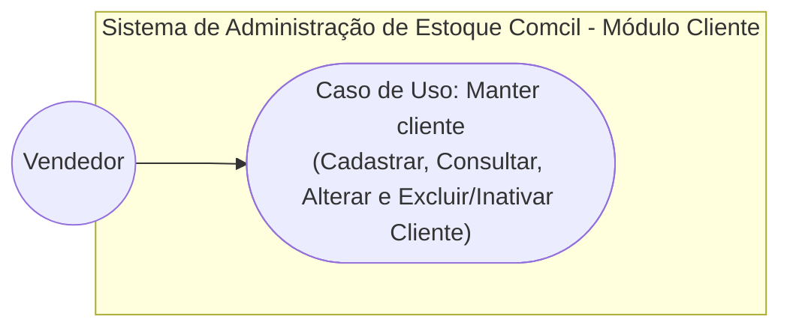
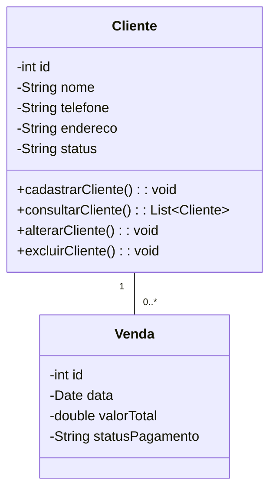
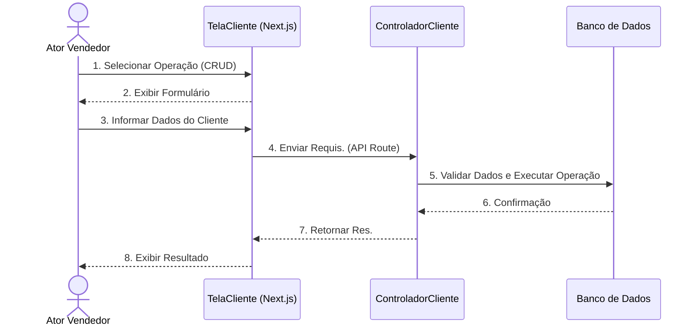
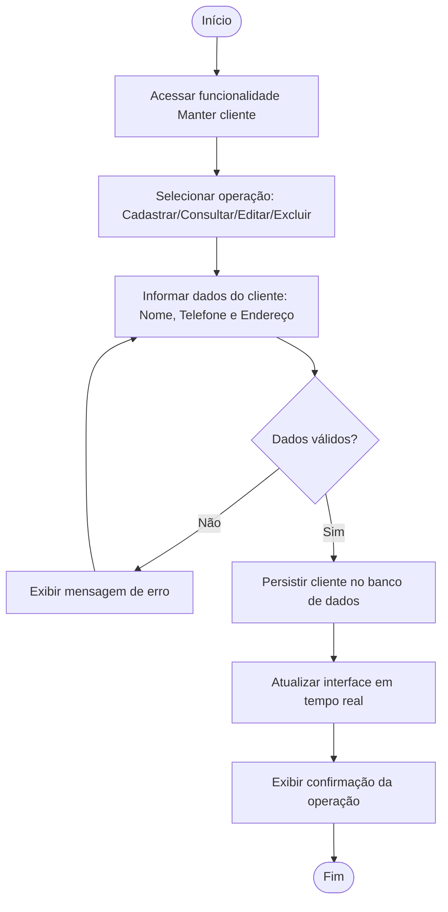

# Documento de Modelos

## Histórico de Revisões

| Data | Versão | Descrição | Autor |
| :--- | :--- | :--- | :--- |
| 05/11/2026 | 1.0 | Criação do Documento de Modelos com foco no CRUD de Clientes da Comcil | Daniel Mariz, Jonas Jerônimo, Gabriel Samir, Leandro Isaac |
| 11/11/2026 | 1.1 | Alinhamento com o relatório de OSM: nome do sistema, atributo status, consulta no fluxo de atividades, regras RN02/RN03 | Daniel Mariz, Jonas Jerônimo, Gabriel Samir, Leandro Isaac |

---

## 1. Diagrama de Casos de Uso

O diagrama a seguir especifica as funcionalidades do sistema propostas no projeto de OSM para a empresa Comcil. Para o escopo prático desta disciplina, a equipe focará na implementação do caso de uso **Manter cliente**.

### 1.1 Descrição dos Casos de Uso

#### UC01 - Manter Cliente (Escopo Principal da Implementação)
* **Descrição:** Permitir o cadastro, consulta, alteração e exclusão/inativação de clientes da Comcil.
* **Ator Principal:** Vendedor.
* **Pré-condições:** Usuário autenticado na aplicação web (caso de uso *Fazer login* do relatório de OSM; nesta entrega o acesso ao módulo é direto, sem login).
* **Pós-condições:** Dados do cliente mantidos e persistidos com sucesso.

---

## 2. Diagrama de Classes

O diagrama de classes a seguir apresenta a estrutura das entidades do sistema. A entidade `Cliente` centraliza os atributos cadastrais e relaciona-se com as vendas efetuadas na empresa.

### 2.1 Descrição das Entidades Principais

* **Cliente:** Armazena `id`, `nome`, `telefone`, `endereco` e `status` (Ativo/Inativo). Responsável pelas operações de CRUD.
* **Venda:** Armazena o histórico de vendas realizadas, mantendo a relação de 1 cliente para 0..* vendas ($1 : N$).

---

## 3. Diagramas de Sequência

### 3.1 Diagrama de Sequência - CRUD de Clientes (Manter Cliente)

O diagrama de sequência descreve o fluxo de mensagens entre a interface gráfica desenvolvida em **Next.js** (App Router), os controladores da API e a camada de dados para as operações do CRUD de Clientes.

#### Fluxo de Mensagens:
1. O **Vendedor** acessa a tela de gestão de clientes (`/clientes`) e preenche o formulário de cadastro ou solicita edição/remoção.
2. A **TelaCliente** encaminha a requisição HTTP (`POST`, `PUT`, `DELETE` ou `GET`) para o **ControladorCliente**.
3. O **ControladorCliente** valida se o campo `nome` está preenchido e garante que não há duplicações.
4. O sistema executa a operação na **Base de Dados** e retorna a resposta com mensagem de sucesso ou erro.

---

## 4. Diagrama de Atividades

### 4.1 Diagrama de Atividade - Manter Cliente (CRUD de Clientes)

O diagrama de atividades a seguir representa o fluxo de execução das ações do utilizador e do sistema no processo de manutenção de clientes.

---

## 5. Especificação de Casos de Uso

### 5.1 UC01 - Manter Cliente

**Nome:** Manter cliente.  
**Objetivo:** Permitir o cadastro, consulta, alteração e exclusão de clientes vinculados à Comcil.  
**Atores:** Vendedor.  

#### Fluxo Principal:
1. O usuário acessa a funcionalidade de manutenção de clientes.
2. O sistema exibe a lista de clientes cadastrados e as opções para Novo Cadastro, Alteração ou Exclusão.
3. O usuário informa os dados do cliente (Nome, Telefone, Endereço) ou seleciona um registro existente.
4. O sistema valida os campos obrigatórios.
5. O usuário confirma a operação.
6. O sistema persiste as informações e atualiza a interface visual em tempo real.

#### Fluxos Alternativos:
- **A1 - Cliente Duplicado:** O sistema identifica um cliente já cadastrado com o mesmo nome e telefone e exibe mensagem de alerta, impedindo o novo registro.
- **A2 - Consulta por Nome ou Código:** O usuário utiliza a barra de busca para filtrar os resultados da tabela.

#### Fluxos de Exceção:
- **E1 - Campos Obrigatórios Não Preenchidos:** O sistema destaca os campos faltantes (ex.: Nome) e impede a confirmação.
- **E2 - Falha de Comunicação:** Caso ocorra erro na gravação dos dados, o sistema cancela a operação e exibe notificação de falha.

#### Regras de Negócio:
- **RN01:** Todo cliente deve possuir identificação única (`id`) e `nome` preenchido.
- **RN02 (Exclusão Lógica):** Clientes com histórico de vendas vinculadas não devem ser excluídos fisicamente da base de dados; a operação altera apenas seu status para "Inativo"; clientes sem vendas podem ser excluídos fisicamente.
- **RN03 (Consulta):** O sistema deve permitir a consulta por nome ou código.

---

## 6. Protótipos de Tela (Wireframes)

- **Tela de Listagem e Cadastro de Clientes (`/clientes`):** Interface responsiva em Next.js e Tailwind CSS composta por tabela interativa contendo colunas de Nome, Telefone, Endereço e Ações (Editar / Excluir), acompanhada de formulário modal/seção para inclusão e edição rápida de dados.