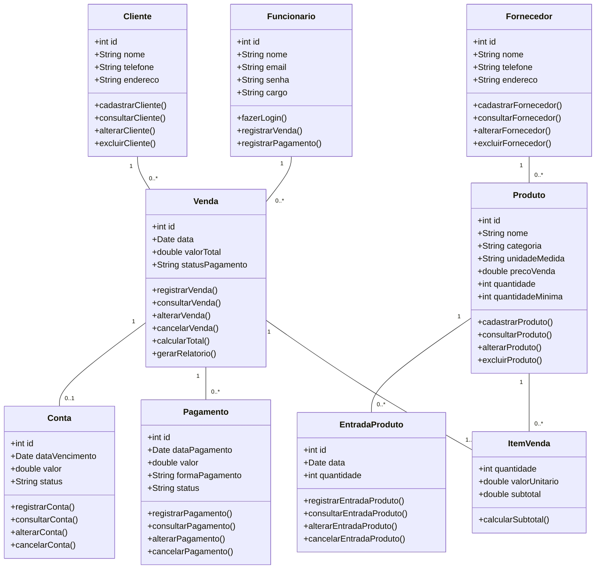
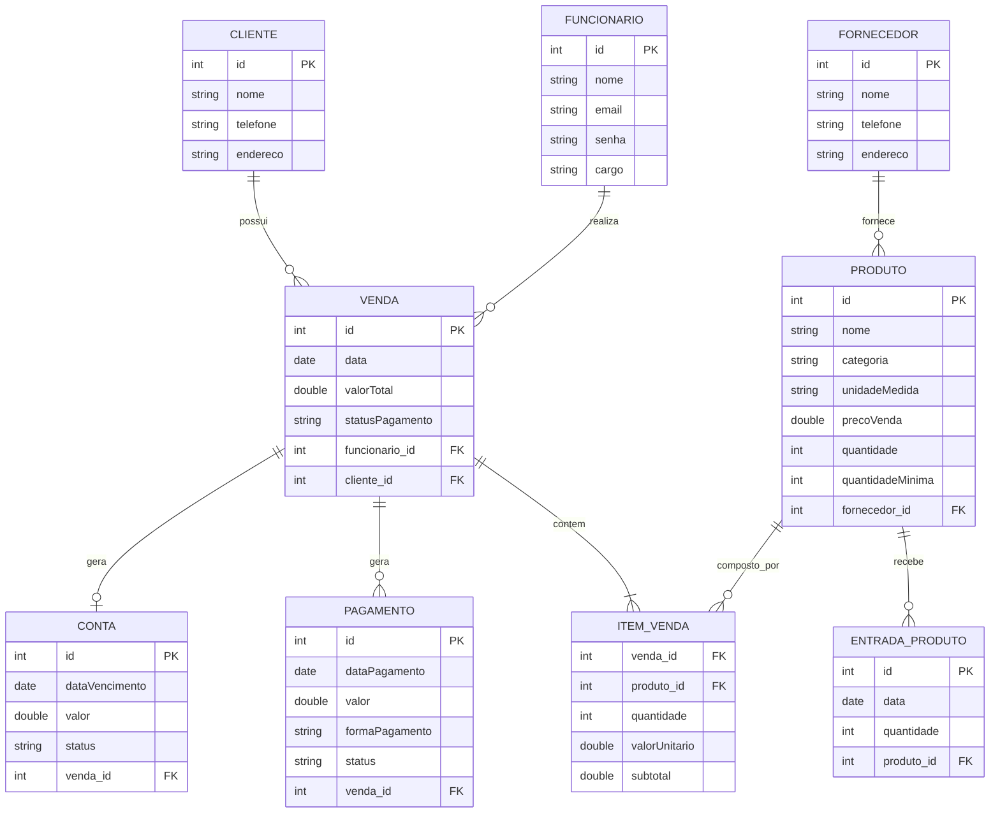

# Documento de Modelos

Neste documento temos o modelo Conceitual (UML) ou de Dados (Entidade-Relacionamento). Temos também a descrição das entidades e o dicionário de dados.

Para a modelagem pode se usar o Astah UML ou o BrModelo. Uma ferramenta interessante para modelos UML é a [YUML](http://yuml.me), no link temos um exemplo de [Modelo UML com YUML](yuml/monitoria-yuml.md). Atualmente é possível usar a ferramenta **Mermaid** segundo o blog do GitHub [Include diagrams in your Markdown files with Mermaid](https://github.blog/2022-02-14-include-diagrams-markdown-files-mermaid/). A documentação do **Mermaid** pode ser encontrada em [Mermaid in GitHub](https://mermaid-js.github.io/mermaid).

## Modelo Conceitual

### Diagrama de Classes usando Mermaid

### Descrição das Entidades

Descrição sucinta das entidades presentes no sistema.

| Entidade | Descrição |
|----------|-----------|
| Funcionario | Representa os colaboradores da empresa responsáveis pela operação do sistema, autenticação e realização de vendas e pagamentos. |
| Cliente | Entidade que armazena as informações dos clientes atendidos nas operações de venda da empresa. |
| Fornecedor | Entidade que representa os fornecedores parceiros responsáveis pelo fornecimento de matérias-primas e produtos. |
| Produto | Representa os itens cadastrados no estoque (matérias-primas e produtos embalados), contendo dados sobre preços e quantidades em estoque. |
| Venda | Entidade central do processo de saída de mercadorias, responsável por agrupar os itens vendidos, calcular totais e status financeiro. |
| ItemVenda | Representa a associação entre um Produto específico e uma Venda, registrando a quantidade vendida e os valores parciais. |
| Pagamento | Armazena as informações relativas às transações financeiras e quitações efetuadas para vendas à vista. |
| Conta | Registra as informações relativas a contas a receber geradas para vendas efetuadas a prazo. |
| EntradaProduto | Registra formalmente a chegada e movimentação de entrada de produtos ao estoque, com quantidades e datas. |

---

## Modelo de Dados (Entidade-Relacionamento)

Para criar modelos ER é possível usar o BrModelo e gerar uma imagem. Contudo, atualmente é possível criar modelos ER usando a ferramenta **Mermaid**, escrevendo o modelo diretamente em markdown. Acesse a documentação para escrever modelos [ER Diagram Mermaid](https://mermaid-js.github.io/mermaid/#/entityRelationshipDiagram).

### Dicionário de Dados

| Tabela | PRODUTO |
| ---------- | ----------- |
| Descrição | Armazena as informações dos produtos e matérias-primas gerenciados no estoque da empresa. |
| Observação | Os produtos podem estar em estado bruto (matéria-prima) ou embalados para comercialização. |

| Nome | Descrição | Tipo de Dado | Tamanho | Restrições de Domínio |
| ------------- | -------------------------------- | ------------ | ------- | --------------------- |
| id | identificador gerado pelo SGBD | SERIAL | --- | PK / Identity |
| nome | nome do produto ou tempero | VARCHAR | 150 | Not Null |
| categoria | categoria do item (Ex: Matéria-prima, Embalado) | VARCHAR | 50 | Not Null |
| unidadeMedida | unidade de medida (Ex: kg, un, pct) | VARCHAR | 15 | Not Null |
| precoVenda | preço de venda unitário | NUMERIC | 10,2 | Not Null / >= 0 |
| quantidade | quantidade atual disponível em estoque | INTEGER | --- | Not Null / >= 0 |
| quantidadeMinima| estoque mínimo para alerta de reposição | INTEGER | --- | Not Null / >= 0 |
| fornecedor_id | código do fornecedor do produto | SERIAL | --- | FK / Not Null |

---

| Tabela | VENDA |
| ---------- | ----------- |
| Descrição | Armazena o cabeçalho das transações de vendas efetuadas aos clientes. |
| Observação | Contém a relação com o funcionário que realizou a operação e com o cliente comprador. |

| Nome | Descrição | Tipo de Dado | Tamanho | Restrições de Domínio |
| ------------- | -------------------------------- | ------------ | ------- | --------------------- |
| id | identificador gerado pelo SGBD | SERIAL | --- | PK / Identity |
| data | data e hora em que a venda foi efetuada | TIMESTAMP | --- | Not Null |
| valorTotal | valor total da venda | NUMERIC | 10,2 | Not Null / >= 0 |
| statusPagamento| status atual do pagamento da venda | VARCHAR | 30 | Not Null |
| funcionario_id| código do funcionário responsável | SERIAL | --- | FK / Not Null |
| cliente_id | código do cliente comprador | SERIAL | --- | FK / Not Null |

---

| Tabela | ITEM_VENDA |
| ---------- | ----------- |
| Descrição | Detalha cada produto vinculado a uma determinada venda. |
| Observação | Permite a composição de múltiplos itens em um único registro de venda. |

| Nome | Descrição | Tipo de Dado | Tamanho | Restrições de Domínio |
| ------------- | -------------------------------- | ------------ | ------- | --------------------- |
| venda_id | identificador da venda associada | SERIAL | --- | PK / FK / Not Null |
| produto_id | identificador do produto associado | SERIAL | --- | PK / FK / Not Null |
| quantidade | quantidade vendida do produto | INTEGER | --- | Not Null / > 0 |
| valorUnitario | valor do produto no momento da venda | NUMERIC | 10,2 | Not Null / > 0 |
| subtotal | cálculo de quantidade x valor unitário | NUMERIC | 10,2 | Not Null / > 0 |