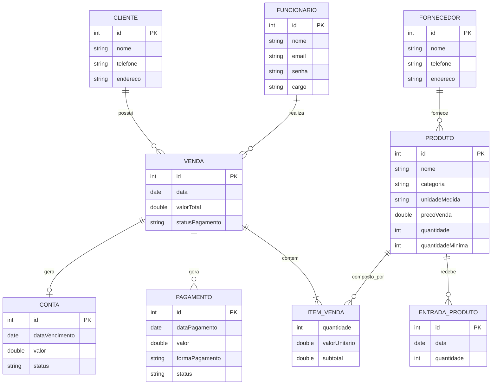

# Documento de Visão

Documento construído a partir do **Modelo BSI - Doc 001 - Documento de Visão**.

## Descrição do Projeto

A Comcil é uma empresa familiar fundada em 1998, localizada em Caicó/RN, especializada no segmento de embalagem e distribuição de temperos no estado do Rio Grande do Norte. O projeto consiste na análise, diagnóstico e proposição de um **Sistema de Administração de Estoque** para automatizar o controle e gerenciamento dos estoques da empresa (composto por estoque de matérias-primas/produtos não embalados e estoque de produtos acabados/embalados).

O sistema visa substituir os controles manuais, garantir o acompanhamento das movimentações de entrada e saída em tempo real, automatizar as atualizações de saldos, controlar vendas (à vista e a prazo), além de apoiar a tomada de decisões por meio da geração de relatórios gerenciais e acompanhamento de estoque mínimo.

## Equipe e Definição de Papéis

| Membro | Papel | E-mail | 
| ----- | ----- | ----- | 
| Karliane Medeiros Ovídio Vale | Cliente Professor / Orientadora | karliane@ceres.ufrn.br | 
| Jonas Jerônimo Cirilo Silva | Analista de Sistemas / Desenvolvedor | jonas@comcil.com.br | 
| Leandro Isaac | Gerente de Projeto / Desenvolvedor | leandro@comcil.com.br | 
| Daniel Mariz | Projetista de Banco de Dados / Desenvolvedor | daniel@comcil.com.br | 
| Gabriel Uchoa | Testador / Analista de Qualidade | gabriel@comcil.com.br | 

### Matriz de Competências

| Membro | Competências | 
| ----- | ----- | 
| Karliane Medeiros Ovídio Vale | Gestão Acadêmica, Engenharia de Software, Organização de Sistemas e Métodos | 
| Jonas Jerônimo Cirilo Silva | Levantamento de Requisitos, Modelagem UML, Análise de Processos | 
| Leandro Isaac | Gestão de Projetos, Arquitetura de Software, Modelagem UML | 
| Daniel Mariz | Modelagem de Banco de Dados, SQL, Desenvolvimento de Software | 
| Gabriel Uchoa | Testes de Software, Garantia de Qualidade, Engenharia de Requisitos | 

## Perfis dos Usuários

O sistema poderá ser utilizado por diversos usuários dentro da estrutura da empresa. Temos o seguinte perfil principal identificado na modelagem:

| Perfil | Descrição | 
| ----- | ----- | 
| Vendedor / Colaborador | Usuário do sistema responsável pelo cadastro de entidades base (produtos, fornecedores, clientes), registro de entradas de mercadorias, realização e acompanhamento de vendas, controle financeiro básico (pagamentos/contas a receber), consulta de saldos e geração de relatórios. | 

## Lista de Requisitos Funcionais

### Entidade Autenticação - US01 - Fazer Login

Permite o acesso seguro dos usuários ao sistema de administração de estoque mediante validação de credenciais.

| Requisito | Descrição | Ator | 
| ----- | ----- | ----- | 
| RF01.01 - Autenticar Usuário | Realizar login no sistema informando e-mail/login e senha. | Vendedor | 
| RF01.02 - Bloquear Acesso Inativo | Impedir o acesso de usuários desativados ou inativos. | Vendedor | 
| RF01.03 - Encerrar Sessão | Permitir que o usuário realize logout do sistema de forma segura. | Vendedor | 

### Entidade Produto - US02 - Manter Produto

Gerencia as matérias-primas e produtos acabados comercializados e embalados pela empresa.

| Requisito | Descrição | Ator | 
| ----- | ----- | ----- | 
| RF02.01 - Inserir Produto | Insere novo produto informando: nome, categoria, unidade de medida, preço de venda, quantidade inicial e quantidade mínima. | Vendedor | 
| RF02.02 - Listar/Consultar Produtos | Consulta produtos cadastrados com filtros por nome, categoria ou disponibilidade em estoque. | Vendedor | 
| RF02.03 - Atualizar Produto | Atualiza os dados de um produto existente (nome, categoria, preço, unidade de medida, etc.). | Vendedor | 
| RF02.04 - Deletar/Inativar Produto | Inativa ou exclui o cadastro de um produto (impedindo a remoção física caso haja histórico de vendas ou entradas). | Vendedor | 

### Entidade Fornecedor - US03 - Manter Fornecedor

Gerencia os fornecedores parceiros responsáveis pelo fornecimento de matérias-primas e suprimentos.

| Requisito | Descrição | Ator | 
| ----- | ----- | ----- | 
| RF03.01 - Inserir Fornecedor | Insere novo fornecedor informando: nome, telefone e endereço. | Vendedor | 
| RF03.02 - Listar Fornecedores | Listagem e consulta de fornecedores cadastrados utilizando filtros por nome ou código. | Vendedor | 
| RF03.03 - Atualizar Fornecedor | Atualiza informações de contato e endereço de um fornecedor cadastrado. | Vendedor | 
| RF03.04 - Deletar/Inativar Fornecedor | Impede a exclusão física caso o fornecedor possua histórico de entradas, efetuando apenas inativação. | Vendedor | 

### Entidade Cliente - US04 - Manter Cliente

Gerencia os dados dos clientes vinculados às vendas realizadas pela empresa.

| Requisito | Descrição | Ator | 
| ----- | ----- | ----- | 
| RF04.01 - Inserir Cliente | Insere novo cliente informando: nome, telefone e endereço. | Vendedor | 
| RF04.02 - Listar Clientes | Consulta a lista de clientes cadastrados por nome ou código. | Vendedor | 
| RF04.03 - Atualizar Cliente | Atualiza os dados cadastrais e de contato de um cliente. | Vendedor | 
| RF04.04 - Deletar/Inativar Cliente | Permite apenas a inativação cadastral caso o cliente já possua vendas vinculadas. | Vendedor | 

### Entidade Entrada - US05 - Registrar Entrada de Produtos

Registra a recepção de novas matérias-primas e mercadorias no estoque, atualizando a quantidade em saldo de forma automática.

| Requisito | Descrição | Ator | 
| ----- | ----- | ----- | 
| RF05.01 - Registrar Entrada | Registra a chegada de itens vinculando produto, fornecedor, quantidade recebida e data. | Vendedor | 
| RF05.02 - Validar Dados de Entrada | Valida se a quantidade informada é maior que zero e se o produto e fornecedor existem. | Vendedor | 
| RF05.03 - Atualizar Estoque Automático | Incrementa automaticamente a quantidade no estoque do produto após gravação da entrada. | Vendedor | 

### Entidade Venda - US06 - Registrar e Gerenciar Vendas

Processa a saída de produtos para comercialização, validando disponibilidade de estoque e gerando recebimentos.

| Requisito | Descrição | Ator | 
| ----- | ----- | ----- | 
| RF06.01 - Registrar Venda | Registra a venda selecionando o cliente, itens (produtos e quantidades) e calculando totais. | Vendedor | 
| RF06.02 - Validar Disponibilidade | Verifica se há saldo em estoque suficiente antes da confirmação da venda. | Vendedor | 
| RF06.03 - Processar Pagamento à Vista | Registra pagamento em dinheiro/cartão em vendas à vista e atualiza status. | Vendedor | 
| RF06.04 - Processar Venda a Prazo | Gera registro de contas a receber com data de vencimento para vendas a prazo. | Vendedor | 
| RF06.05 - Emitir Comprovante | Emite o comprovante de venda imediatamente após o fechamento da operação. | Vendedor | 
| RF06.06 - Consultar/Alterar Venda | Permite visualizar detalhes da venda e ajustar itens calculando diferença em estoque. | Vendedor | 
| RF06.07 - Cancelar Venda | Cancela a venda realizada, estornando os itens vendidos de volta ao saldo do estoque. | Vendedor | 

### Entidade Relatório - US07 - Gerar Relatórios

Oferece visões consolidadas sobre os processos operacionais e financeiros da empresa.

| Requisito | Descrição | Ator | 
| ----- | ----- | ----- | 
| RF07.01 - Gerar Relatório de Estoque | Exibe o status atual das quantidades de matérias-primas e produtos embalados. | Vendedor | 
| RF07.02 - Gerar Relatório de Vendas | Consolida as vendas efetuadas por período, cliente ou forma de pagamento. | Vendedor | 
| RF07.03 - Gerar Relatório de Entradas | Exibe o histórico de recebimento de produtos por fornecedor e período. | Vendedor | 

### Modelo Conceitual

Abaixo apresentamos o modelo conceitual de entidades usando o **Mermaid**.

#### Descrição das Entidades

| Entidade | Descrição | 
| ----- | ----- | 
| FUNCIONARIO | Armazena os dados dos funcionários autorizados a operar o sistema. | 
| CLIENTE | Registra os clientes da empresa vinculados às vendas efetuadas. | 
| FORNECEDOR | Armazena informações dos parceiros fornecedores de produtos e matérias-primas. | 
| PRODUTO | Mantém os registros das matérias-primas e temperos embalados, preços e saldo de estoque. | 
| ENTRADA_PRODUTO | Registra a movimentação de entrada e reposição de itens no estoque. | 
| VENDA | Armazena o registro principal das transações de vendas efetuadas aos clientes. | 
| ITEM_VENDA | Tabela associativa que detalha os produtos e quantidades presentes em uma venda. | 
| PAGAMENTO | Registra as quitações e recebimentos de vendas realizadas à vista. | 
| CONTA | Registra os lançamentos de contas a receber gerados por vendas efetuadas a prazo. | 

## Lista de Requisitos Não-Funcionais

| Requisito | Descrição | 
| ----- | ----- | 
| RNF001 - Interface Intuitiva | Possuir interface simples, amigável e de fácil navegação para usuários operacionais. | 
| RNF002 - Segurança de Banco de Dados | Armazenar as informações em um Banco de Dados seguro e resiliente. | 
| RNF003 - Controle de Acesso | Permitir acesso às funcionalidades e dados apenas a usuários devidamente autenticados. | 
| RNF004 - Integridade dos Dados | Garantir a integridade referencial das informações (impedir exclusões indevidas de registros vinculados). | 
| RNF005 - Mecanismo de Backup | Possibilitar a realização de backups periódicos dos dados do sistema. | 
| RNF006 - Desempenho em Consultas | Apresentar excelente desempenho e resposta rápida na execução de consultas de estoque e vendas. | 

## Riscos

Tabela com o mapeamento dos riscos do projeto, as possíveis soluções e os responsáveis.

| Data | Risco | Prioridade | Responsável | Status | Providência/Solução | 
| ----- | ----- | ----- | ----- | ----- | ----- | 
| 10/02/2026 | Resistência dos funcionários ao uso do sistema informatizado | Alta | Gerente | Vigente | Realizar treinamentos práticos com interface simplificada | 
| 10/02/2026 | Inconsistência entre os estoques físico (matéria-prima vs acabados) e lógico | Alta | Analista | Vigente | Realizar inventário inicial rigoroso antes da carga de dados | 
| 15/02/2026 | Falha de comunicação ou queda da conexão com o banco de dados | Média | Projetista | Vigente | Implementar tratamento de exceção adequado (rollbacks e mensagens claras ao usuário) | 
| 20/02/2026 | Indisponibilidade da diretoria para validação dos protótipos de tela | Baixa | Gerente | Vigente | Agendar reuniões periódicas curtas com base na disponibilidade da gestão familiar | 

### Referências

\[1\] CURY, Antonio. Organização e Métodos: uma visão holística. 9. ed. São Paulo: Atlas, 2017.

\[2\] PRESSMAN, Roger S. Engenharia de Software. 9. ed. Porto Alegre: AMGH, 2021.